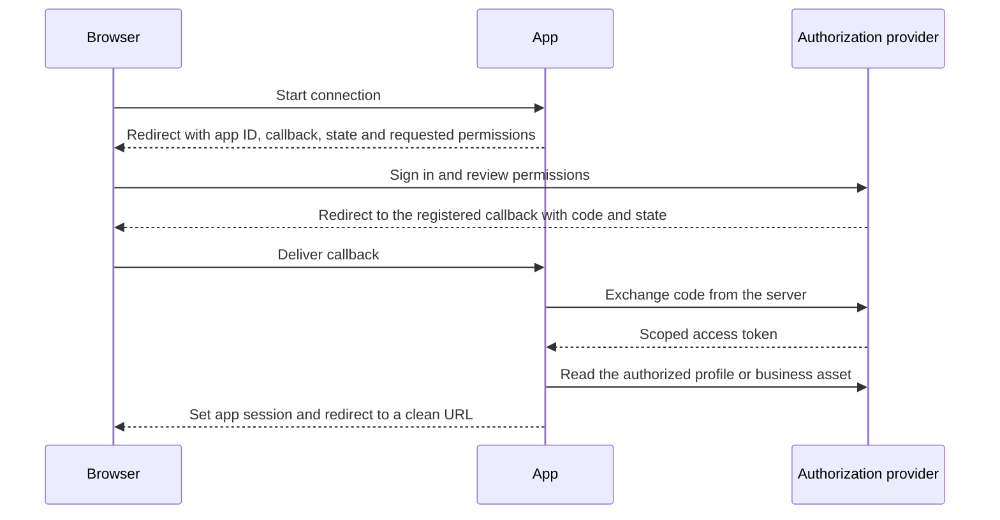

# How Instagram and Facebook OAuth work

Research checked 19 November 2026 against Meta’s developer documentation and the OAuth 2.0 security standards.

## The products Meta offers

| Product | User signs in with | What the app receives | Where the app calls |
|---|---|---|---|
| **Facebook Login** | A Facebook account | A Facebook user access token for the person and the permissions they approved | `graph.facebook.com`, for example the Facebook profile |
| **Instagram API with Unified Login** | Facebook or Instagram | A business integration system-user token for assets a business portfolio shares | `graph.facebook.com`, using an Instagram professional account ID |
| **Instagram API with Instagram Login** | An Instagram professional account | An Instagram user access token tied to that app and account | `graph.instagram.com`, including `/me` for the Instagram identity |
| **Instagram API with Facebook Login** | A Facebook user with access to a Facebook Page linked to a professional Instagram account | A Facebook user token, with Page tokens available for eligible Pages | `graph.facebook.com`, through the Page and its linked Instagram account |

Meta recommends **Unified Login** for new Instagram integrations. It supports creator and business accounts, requires a business portfolio, and does not require a Facebook Page. The Instagram-only flow also works without a Page and uses its own app ID, secret, and `instagram_business_*` permissions. The Page-linked flow uses Facebook Login for Business, the `instagram_*` permissions, and applicable Page permissions. The three Instagram APIs serve professional accounts. [Meta Instagram Platform overview](https://developers.facebook.com/documentation/instagram-platform/overview) · [Meta Facebook Login](https://developers.facebook.com/documentation/facebook-login/guides/advanced/manual-flow)

## The authorization-code flow

1. The app generates a fresh **state** value and binds it to the browser that started the transaction. The provider’s authorization request contains the public app ID, a pre-registered redirect URI, and the requested permissions or configuration ID.
2. The user authenticates on the provider’s site and chooses what to authorize. The provider sends the browser to the registered callback with a short-lived, single-use **authorization code**. A denial comes back as an error, and the app should make retrying straightforward.
3. The app checks **state** and exchanges the code from its server. A confidential client authenticates to the token endpoint with its secret. With **PKCE**, a fresh verifier stays with the client and the authorization request contains only its SHA-256 challenge. Redemption requires the matching verifier.
4. The app uses the scoped **access token** to read an identity or an authorized asset. The app can then issue its own **session cookie**. The browser session and the provider’s access token have separate lifetimes and privileges.

Sources for the code flow and controls. [RFC 6749, authorization code grant](https://www.rfc-editor.org/rfc/rfc6749#section-4.1) · [RFC 7636, PKCE](https://www.rfc-editor.org/rfc/rfc7636.html) · [RFC 9700, OAuth security practices](https://www.rfc-editor.org/rfc/rfc9700.html)

## What the requests look like for each Meta setup

**Instagram-only Business Login.** The browser goes to `www.instagram.com/oauth/authorize`. The app asks for permissions such as `instagram_business_basic`. The server exchanges the callback code with a POST to `api.instagram.com/oauth/access_token` using the Instagram app ID and secret and the identical redirect URI. Meta documents a one-hour, single-use authorization code and a one-hour short-lived token. An app can read `user_id` and `username` from its Instagram graph `/me`. Meta also documents a server-side exchange to a 60-day token and a refresh flow if needed. The current Instagram-only parameter reference documents `state` and does not list PKCE. [Meta Business Login for Instagram](https://developers.facebook.com/documentation/instagram-platform/instagram-api-with-instagram-login/business-login) · [Meta Instagram Login getting started](https://developers.facebook.com/documentation/instagram-platform/instagram-api-with-instagram-login/get-started)

**Facebook Login.** The browser goes to Facebook’s versioned login dialog. In the authorization-code flow, the server calls the versioned Facebook Graph token endpoint with the Facebook app credentials and the original redirect URI. The Graph API provides Facebook profile data under the granted permissions. For Page-linked Instagram integrations, Meta’s onboarding guide starts with `instagram_basic` and `pages_show_list`, then reads eligible Pages and finds the linked professional Instagram account. [Meta manual Facebook Login](https://developers.facebook.com/documentation/facebook-login/guides/advanced/manual-flow) · [Meta Page-linked Instagram getting started](https://developers.facebook.com/documentation/instagram-platform/instagram-api-with-facebook-login/get-started)

**Unified Login.** The Meta App Dashboard issues a **configuration ID** that selects the requested assets and permissions. The person signs in with Facebook or Instagram, picks a business portfolio and shares the relevant Instagram accounts. The app exchanges the code using the **Meta** app ID and secret. The resulting token is for the business integration, so `/me` identifies the system user. Meta documents `/me/assigned_instagram_accounts` for finding the shared professional accounts. The app should store tokens server-side and associate them with the client business and configuration. [Meta Unified Login onboarding](https://developers.facebook.com/documentation/instagram-platform/instagram-api-with-unified-login/get-started) · [Meta Unified Login authentication and tokens](https://developers.facebook.com/documentation/instagram-platform/instagram-api-with-unified-login/authentication)

## What runs in The Wrong Window

The challenge implements an OAuth authorization-code flow with a **dedicated demo issuer on a separate HTTPS origin**. The player sees a consent screen and authorizes only a fictional creator account. The app validates browser-bound state, exchanges a single-use code with S256 PKCE and client authentication, reads a demo profile server-to-server, and sets an HttpOnly session cookie. Browser DevTools shows the authorization request and redirect. The code exchange, access token, and profile request stay on the server. The callback immediately redirects to the clean studio URL.

The write-up inspired the investigation into a window trust failure. The game uses recorded evidence for that part. Browser messaging is a separate mechanism from OAuth. For an application that uses messaging, exact sender origin, expected window and message type are separate checks. Keep the callback page and authorization data away from analytics and unrelated scripts. [Youssef Sammouda’s write-up](https://ysamm.com/uncategorized/2026/01/16/leaking-fbevents-ato.html) · [MDN Web Messaging](https://developer.mozilla.org/en-US/docs/Web/API/Window/postMessage) · [RFC 9700](https://www.rfc-editor.org/rfc/rfc9700.html)

## What a live Meta hookup requires

For a new Unified Login integration, Meta currently requires an app owned by a business portfolio, the Instagram use case and Facebook Login for Business, access to configure the app, a registered HTTPS redirect, webhook setup, and a professional Instagram account to test with. Standard Access covers eligible role-based tests. Connecting external clients requires Live mode and Advanced Access through App Review for the requested permissions. Meta app configuration and secrets are specific to the operator’s app. The public CTF uses its separate issuer and demo profile. [Meta Unified Login setup and review](https://developers.facebook.com/documentation/instagram-platform/instagram-api-with-unified-login/get-started) · [Meta permission access levels](https://developers.facebook.com/documentation/instagram-platform/instagram-api-with-unified-login/permissions)
